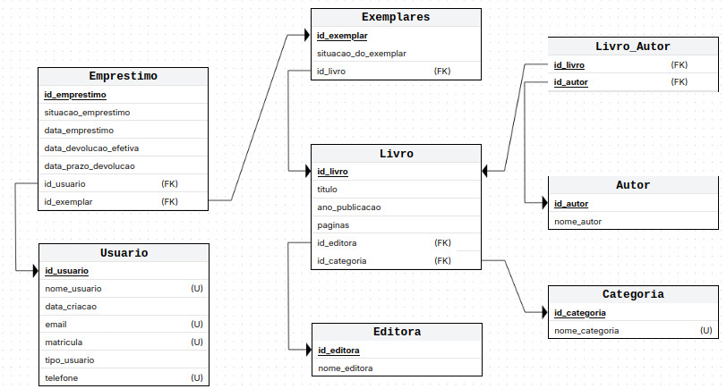

# Sistema de Biblioteca

API REST para administrar o acervo e as operações de uma biblioteca: livros, exemplares, leitores, empréstimos e relatórios. A aplicação foi construída com **FastAPI**, **SQLAlchemy** e **Pydantic**, com persistência relacional e documentação OpenAPI interativa.

[](https://www.python.org/)
[](https://fastapi.tiangolo.com/)
[](https://www.sqlalchemy.org/)

> **Escopo:** o repositório inclui a API, mas não uma interface web.

<p align="center">
  <a href="#-começar">Começar</a> ·
  <a href="#-recursos">Recursos</a> ·
  <a href="#-api">API</a> ·
  <a href="#-modelo-de-dados">Modelo de dados</a> ·
  <a href="#-estrutura">Estrutura</a>
</p>

## 🧰 Recursos

- Cadastro, consulta, atualização e remoção de livros, exemplares, usuários, autores, editoras, categorias e empréstimos.
- Pesquisa de livros por título, categoria, editora e ano de publicação.
- Paginação para listagens de livros e empréstimos.
- Consulta de empréstimos por usuário e histórico de circulação de exemplares.
- Identificação de empréstimos vencidos e consulta da situação de um usuário.
- Estatísticas do acervo e relatórios por categoria.
- Validação de entrada e documentação interativa gerada pelo FastAPI.

## 🚀 Começar

### Requisitos

- Python 3.12 ou superior.
- `pip`.

### Instalar dependências e executar

Na raiz do projeto:

```powershell
python -m venv .venv
.\.venv\Scripts\Activate.ps1
python -m pip install -r requirements.txt
uvicorn app.main:app --reload
```

O servidor fica disponível em <http://127.0.0.1:8000>.

> **Banco de dados:** a aplicação usa SQLite em `alembic/biblioteca.db` por padrão. O esquema não é criado ao iniciar a API. Em uma base nova, aplique `scripts/schema.sql` antes de usar os endpoints. O arquivo `scripts/seed.sql` contém dados de exemplo. Execute `python scripts/povoar_banco.py` uma vez para carregá-los no banco configurado.

### Configurar outro banco

Defina `DATABASE_URL` com uma URL SQLAlchemy antes de iniciar a aplicação. Por exemplo, no PowerShell:

```powershell
$env:DATABASE_URL = "sqlite:///C:/caminho/para/biblioteca.db"
uvicorn app.main:app --reload
```

Para outros bancos, instale também o driver Python correspondente à URL utilizada.

## 📚 Documentação interativa

Com o servidor em execução:

- **Swagger UI:** <http://127.0.0.1:8000/docs>
- **ReDoc:** <http://127.0.0.1:8000/redoc>
- **Especificação OpenAPI:** <http://127.0.0.1:8000/openapi.json>

Os schemas da API estão em `app/schemas/entidades.py`. A documentação OpenAPI é gerada a partir das rotas e dos schemas.

## 🔌 API

Todas as rotas trocam dados em JSON. Os exemplos usam `http://127.0.0.1:8000` como endereço base.

<details open>
<summary><strong>Acervo e cadastros</strong></summary>

| Recurso | Rotas principais |
|---|---|
| **Livros** | `GET /livros/`, `POST /livros/`, `GET /livros/{id}`, `PUT /livros/{id}`, `DELETE /livros/{id}` |
| **Exemplares** | `GET /exemplares/`, `POST /exemplares/`, `GET /exemplares/{id}`, `PUT /exemplares/{id}`, `DELETE /exemplares/{id}` |
| **Usuários** | `GET /usuarios/`, `POST /usuarios/`, `GET /usuarios/{id}`, `PATCH /usuarios/{id}`, `DELETE /usuarios/{id}` |
| **Autores** | `GET /autores/`, `POST /autores/`, `GET /autores/{id}`, `PUT /autores/{id}`, `DELETE /autores/{id}` |
| **Editoras** | `GET /editoras/`, `POST /editoras/`, `GET /editoras/{id}`, `PUT /editoras/{id}`, `DELETE /editoras/{id}` |
| **Categorias** | `GET /categorias/`, `POST /categorias/`, `GET /categorias/{id}`, `PUT /categorias/{id}`, `DELETE /categorias/{id}` |

Rotas relacionadas:

- `GET /livros/{livro_id}/exemplares` — exemplares associados a um livro.
- `GET /autores/{autor_id}/livros` — livros associados a um autor.
- `GET /usuarios/{usuario_id}/emprestimos` — histórico de empréstimos de um usuário.

</details>

<details>
<summary><strong>Empréstimos</strong></summary>

| Método | Rota | Descrição |
|---|---|---|
| `GET` | `/emprestimos/` | Lista empréstimos com filtros e paginação. |
| `POST` | `/emprestimos/` | Cadastra um empréstimo. |
| `GET` | `/emprestimos/{id}` | Consulta um empréstimo. |
| `PUT` | `/emprestimos/{id}` | Atualiza os dados de um empréstimo. |
| `DELETE` | `/emprestimos/{id}` | Remove um empréstimo. |
| `GET` | `/emprestimos/vencidos/` | Identifica e lista empréstimos em atraso. |
| `GET` | `/usuarios/{id_usuario}/situacao` | Consulta a situação da conta do usuário e seus atrasos. |

Na listagem, `page` começa em `1` e `page_size` aceita valores de `1` a `100`. Empréstimos também podem ser filtrados por `id_usuario`, `id_exemplar` e `situacao_emprestimo`.

</details>

### ⚠️ Exclusões e relacionamentos

As rotas `DELETE` não apagam automaticamente os registros dependentes. Como as chaves estrangeiras protegem os relacionamentos, exclua primeiro os registros que apontam para o item desejado e só depois o registro principal:

1. **Empréstimos** (`DELETE /emprestimos/{id}`): remova os empréstimos associados antes de excluir o usuário ou exemplar.
2. **Exemplares** (`DELETE /exemplares/{id}`): depois de remover seus empréstimos, exclua os exemplares antes do livro ao qual pertencem.
3. **Livros** (`DELETE /livros/{id}`): depois de remover seus exemplares, exclua o livro antes da editora ou categoria associada.
4. **Editoras e categorias** (`DELETE /editoras/{id}` e `DELETE /categorias/{id}`): só podem ser removidas quando nenhum livro as referencia.

Autores se relacionam a livros pela tabela `livro_autor`. Ao excluir um autor, o vínculo com as obras é removido, mas os livros permanecem. Se uma exclusão violar uma chave estrangeira ou outra restrição de integridade, a API responde com **HTTP 409 Conflict**. Excluir empréstimos também apaga o histórico. Para preservá-lo, mantenha os empréstimos, os usuários e os exemplares relacionados.

<details>
<summary><strong>Estatísticas e relatórios</strong></summary>

| Método | Rota | Descrição |
|---|---|---|
| `GET` | `/estatisticas/estatisticas` | Indicadores de acervo, empréstimos e páginas por categoria. |
| `GET` | `/relatorios/obras-autores-categorias` | Obras agrupadas por autor e categoria. |
| `GET` | `/relatorios/atrasos-categorias` | Quantidade de atrasos por categoria. |

</details>

### Exemplos rápidos

Listar livros, filtrando por título e usando paginação:

```http
GET /livros/?titulo=Clean&page=1&page_size=10
```

Criar um livro (os IDs de editora, categoria e autores devem existir):

```json
{
  "titulo": "Exemplo de título",
  "ano_publicacao": "2024-01-01",
  "id_editora": "<id-da-editora>",
  "id_categoria": "<id-da-categoria>",
  "id_autores": [],
  "numero_paginas": 240
}
```

Os estados usados pela API são:

- **Empréstimo:** `PENDENTE`, `DEVOLVIDO`, `ATRASADO`.
- **Exemplar:** `DISPONIVEL`, `DANIFICADO`, `EM_EMPRESTIMO`, `RETIRADO_DE_CIRCULACAO`.
- **Usuário:** `SERVIDOR`, `PROFESSOR`, `ALUNO`, `ADMINISTRADOR`.

## 🧩 Modelo de dados



## 🏗️ Estrutura

```text
app/
├── main.py              # Criação da aplicação e registro das rotas
├── database.py          # Engine, sessões e configuração do banco
├── models/              # Entidades SQLAlchemy
├── schemas/             # Schemas Pydantic de entrada e saída
├── routers/             # Endpoints da API
├── crud/                # Operações de persistência
├── services/            # Regras de negócio
└── utils/               # Utilitários compartilhados
alembic/
├── alembic.ini
└── migrations/          # Configuração e versões de migração
scripts/
├── schema.sql           # Definição SQL do esquema
├── seed.sql             # Dados de exemplo
└── povoar_banco.py      # Carregamento do seed
requirements.txt
```

## 🛠 Tecnologias

- **FastAPI** — framework da API e documentação OpenAPI.
- **Pydantic** — validação e serialização de dados.
- **SQLAlchemy** — mapeamento objeto-relacional e acesso ao banco.
- **SQLite** — banco configurado por padrão.
- **Alembic** — arquivos e configuração de migrações presentes no projeto.

